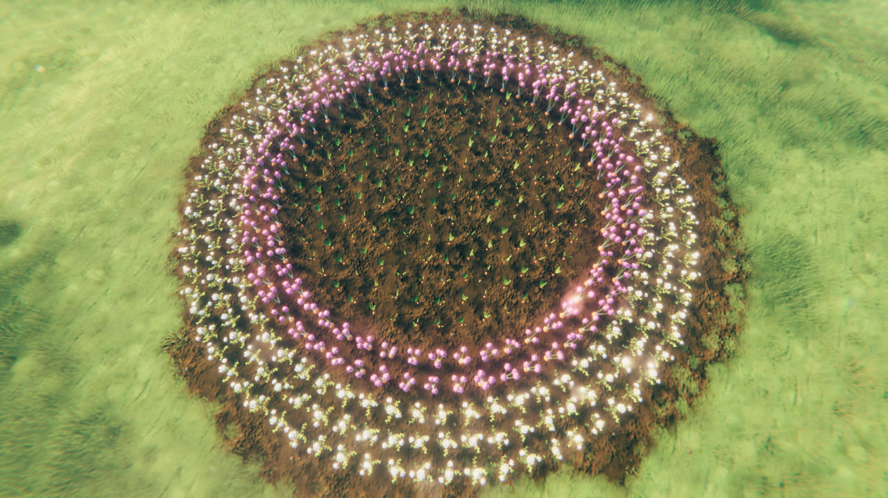
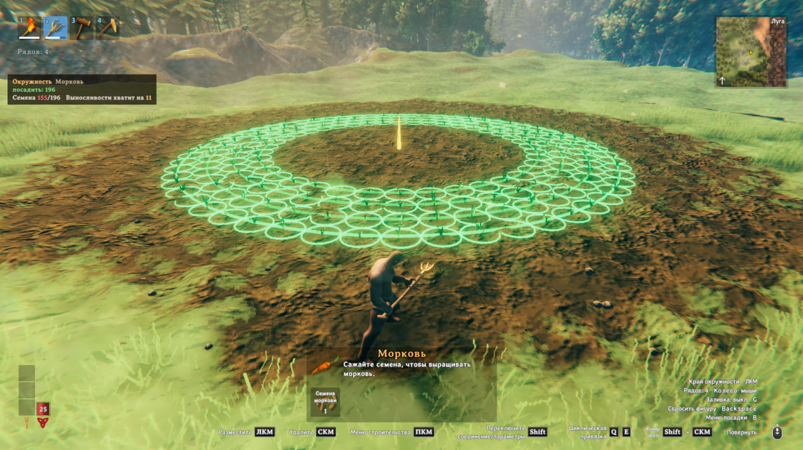
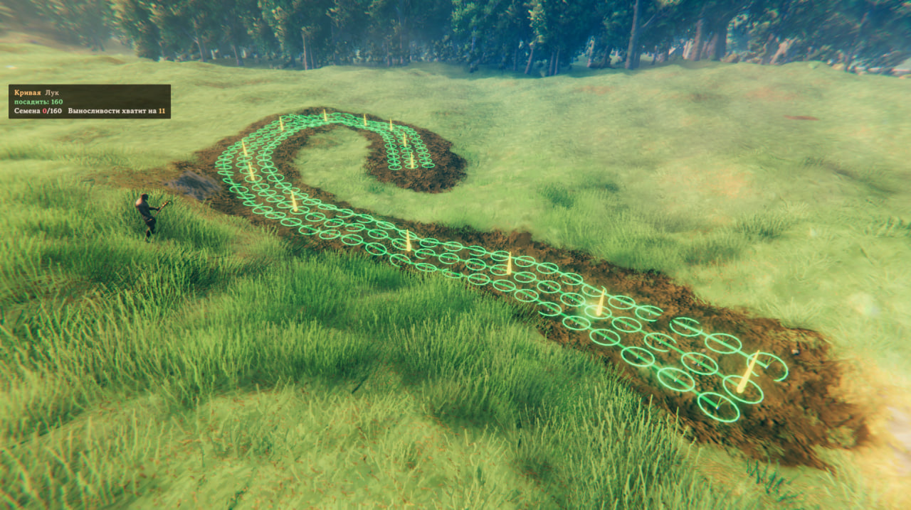
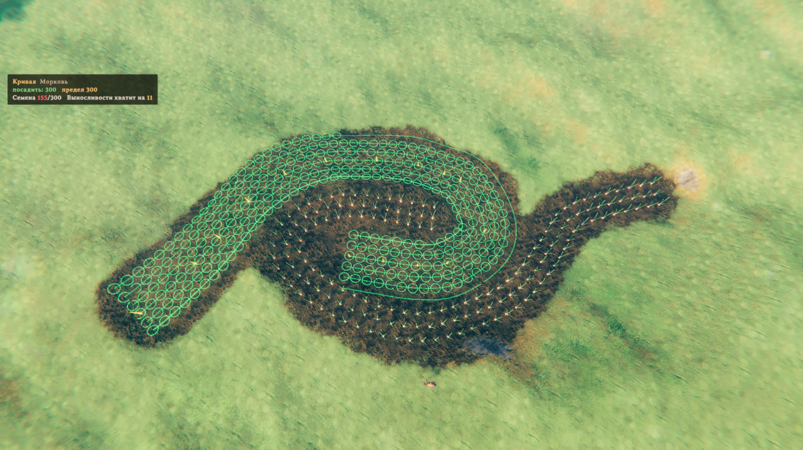
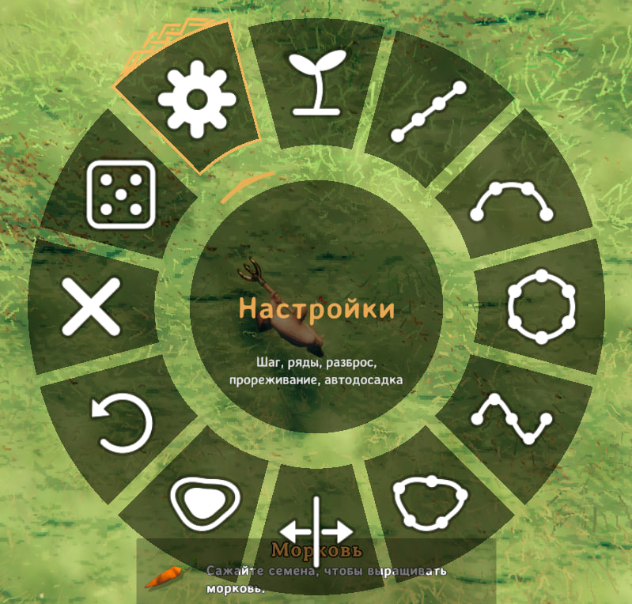
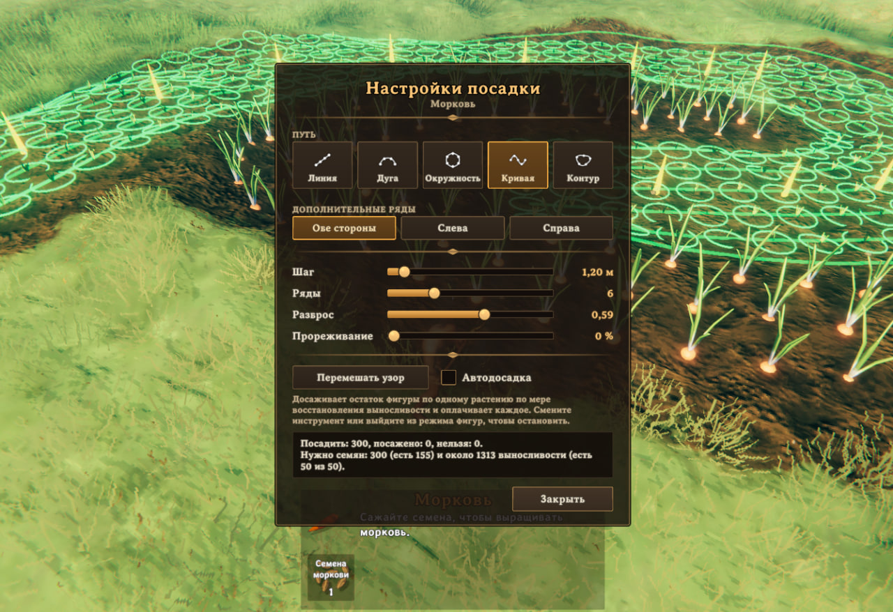

# AdvancedPlanting

    

<!-- repo-only -->
Сделано **kepqa** с помощью **Claude Code**.
<!-- /repo-only -->

Целая грядка за один клик: ряды вдоль линий, дуг, окружностей, кривых и замкнутых контуров, с предпросмотром. Собрать урожай — `Shift` + `E`.

## Быстрый старт

1. Возьмите **культиватор** и выберите семена. Режим фигур включён по умолчанию.
2. **Кликайте**, расставляя точки. Предпросмотр следует за курсором: призраки там, где будут растения, кольца — радиус роста.
3. Линия, дуга и окружность завершаются сами. Кривая или контур — повторным кликом по последней или первой точке, либо `Z`.
4. **Колесо мыши** добавляет и убирает ряды. `G` заливает окружность или контур до центра.
5. **Клик** ещё раз — посажена вся фигура.
6. Когда созреет: зажмите `Shift` и нажмите `E` на одном растении — соберутся все созревшие того же вида в радиусе 5 м.

## Фигуры

| Фигура | Клики | Завершение |
|---|---|---|
| Линия | начало, конец | сама |
| Дуга | начало, середина, конец | сама |
| Окружность | центр, край | сама |
| Кривая | сколько угодно точек | повторный клик по последней точке или `Z` |
| Контур | 3 точки и больше | клик по первой точке или `Z` |

## Управление

Культиватор в руках, выбраны семена:

| Клавиша | Действие |
|---|---|
| `ЛКМ` | Поставить точку / посадить фигуру |
| `Колесо мыши` | Ряды: больше / меньше |
| `Z` | Завершить кривую, замкнуть контур |
| `G` | Заливка окружности или контура: вкл / выкл |
| `Y` | Перенести фигуру под курсор / повторить последнюю |
| `Backspace` | Сбросить фигуру |
| `B` | Меню посадки: фигура, сторона рядов, заливка, отмена точки, настройки |

Везде:

| Клавиша | Действие |
|---|---|
| `Shift` + `E` на созревшем растении | Собрать все созревшие того же вида в радиусе 5 м |

Клавиши для текущего шага видны в игре справа внизу.

## Стоимость

- Каждое растение тратит семена и прочность инструмента и даёт навык, как в игре.
- Выносливость за растение — половина обычной.
- Не хватает выносливости или семян: сначала сажаются ближайшие, остальные остаются в предпросмотре. Кликните позже или включите автодосадку в окне настроек.

## Настройки

Файл: `BepInEx/config/kepqa.AdvancedPlanting.cfg`. Там же меняются все клавиши.

| Настройка | По умолчанию | Значение |
|---|---|---|
| `MaxPlants` | 500 | Растений в фигуре |
| `MaxFigureSize` | 80 м | Наибольший размер фигуры |
| `StaminaCostFactor` | 0.5 | Выносливость за растение: 1 = как в игре, 0 = бесплатно |
| `[3. Harvest] Enabled` | вкл | Сбор по площади вкл / выкл |
| `[3. Harvest] Modifier` | LeftShift | Клавиша, которую держать при сборе |
| `[3. Harvest] Radius` | 5 м | Радиус вокруг собранного растения |
| `[3. Harvest] SameTypeOnly` | вкл | Если выключить, соберутся и ягоды, грибы, кремень и прочее |
| `[4. Server] EnforceOnClients` | вкл | На сервере: игроки получают его настройки выносливости, размеров и сбора |

## Мультиплеер

- Работает на клиенте. Установка на сервер необязательна: тогда настройки сервера действуют для всех игроков.
- Несовместим с другими модами на посадку.

## Перевод

- Английский, русский, украинский, немецкий, французский, испанский, португальский (Бразилия), польский, китайский (упрощённый), японский.
- Файлы: `Translations/<Язык>.txt`, формат `ключ = значение`. Новый язык: скопировать `English.txt` под названием языка из настроек игры.
